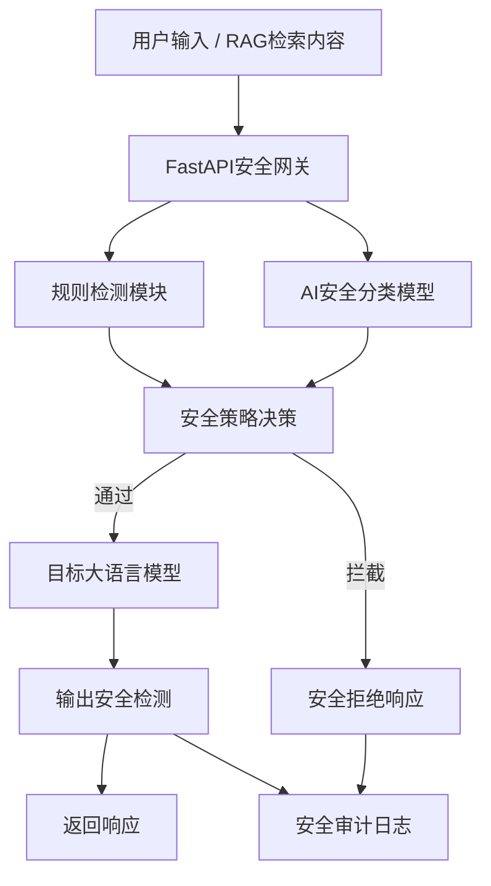

# llm-prompt-guard
# LLM Prompt Guard

**基于大语言模型微调与多层防御机制的 AI 安全网关**


## 1. 项目简介（Introduction）

随着大语言模型（LLM）在 RAG、Agent 和企业智能应用中的广泛使用，提示词注入、模型越狱、敏感信息泄露及工具调用越权等安全问题逐渐凸显。

本项目旨在构建一个轻量化、可部署、可扩展的大模型安全网关，结合传统规则检测、深度学习文本分类、QLoRA 微调及安全策略控制，为大模型应用提供多层安全防护能力。

## 2. 核心功能（Features）

- [ ] Prompt Injection：提示词注入检测
- [ ] Jailbreak Detection：模型越狱检测
- [ ] Indirect Prompt Injection：间接提示词注入检测
- [ ] Sensitive Data Protection：敏感信息保护
- [ ] Security Classification：AI 安全文本分类
- [ ] Access Control：权限与工具调用控制
- [ ] Security Audit：安全审计与日志记录
- [ ] REST API：标准化接口服务
- [ ] Web UI：可视化安全检测界面
- [ ] Docker Deployment：容器化部署

## 3. 技术栈（Tech Stack）

| 技术方向 | 技术选型 |
|---|---|
| 开发语言 | Python |
| 深度学习框架 | PyTorch |
| 基础模型 | Qwen、DistilBERT |
| 模型微调 | LoRA、QLoRA、PEFT |
| 模型量化 | BitsAndBytes、NF4 |
| 模型加载 | Hugging Face Transformers |
| 接口开发 | FastAPI |
| 可视化界面 | Gradio |
| 模型评估 | Scikit-learn |
| 推理部署 | vLLM / Ollama（待选型） |
| 容器化部署 | Docker |

## 4. 系统架构（Architecture）



## 5. 项目目录（Project Structure）

```text
llm-prompt-guard/
├── data/                # 数据集与数据处理
├── models/              # 模型配置
├── training/            # 模型训练与微调
├── evaluation/          # 模型评估
├── guard/               # 安全检测与策略模块
├── api/                 # FastAPI 接口
├── tests/               # 功能与安全测试
├── docs/                # 技术文档
├── requirements.txt     # 项目依赖
├── Dockerfile           # 容器部署配置
└── README.md
```

以上为规划目录，实际结构将随开发逐步完善。

## 6. 模型评估（Evaluation）

项目计划对比传统规则检测、文本分类模型及大语言模型微调方案的实际表现。

| 检测方案 | Accuracy | Precision | Recall | F1 | FPR | 延迟 |
|---|---|---|---|---|---|---|
| Rule-based | — | — | — | — | — | — |
| DistilBERT | — | — | — | — | — | — |
| Qwen Zero-shot | — | — | — | — | — | — |
| Qwen QLoRA (r=8) | — | — | — | — | — | — |
| Qwen QLoRA (r=16) | — | — | — | — | — |

同时关注模型显存占用、推理吞吐量、未知攻击类型泛化能力以及安全检测的误报与漏报问题。

## 7. 开发路线（Roadmap）

- [ ] Phase 1：安全数据集收集与构建
- [ ] Phase 2：数据清洗与基线模型评估
- [ ] Phase 3：LoRA / QLoRA 安全模型微调
- [ ] Phase 4：模型对比与安全评估
- [ ] Phase 5：安全网关及 API 开发
- [ ] Phase 6：可视化界面与 Docker 部署
- [ ] Phase 7：系统测试与技术文档完善

## 8. 安全声明（Security Disclaimer）

本项目仅用于 AI 安全研究、教育学习及合法授权环境下的防御性安全测试。

任何单一检测模型均无法保证完全防御提示词注入及其他大模型安全风险。本项目采用多层防御机制降低风险，并持续评估其安全边界。

## 9. 开源协议（License）

MIT License

## 10. 项目状态（Status）

🚧 Under Active Development

项目正在开发中，实验结果、模型权重说明及部署教程将在相应功能完成后更新。
